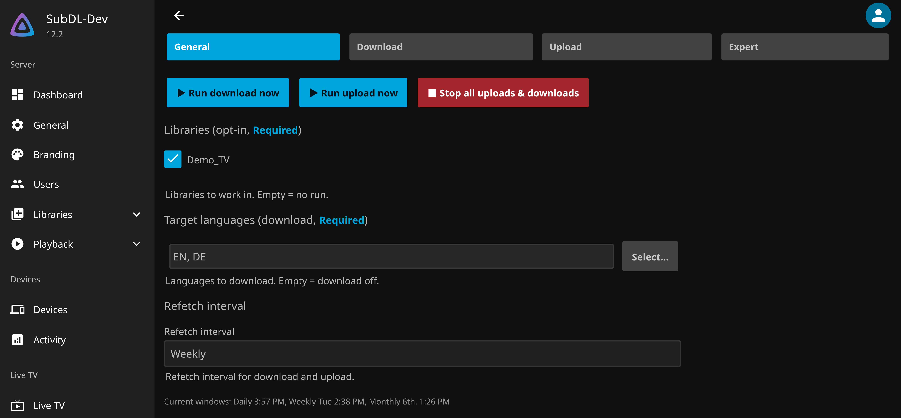
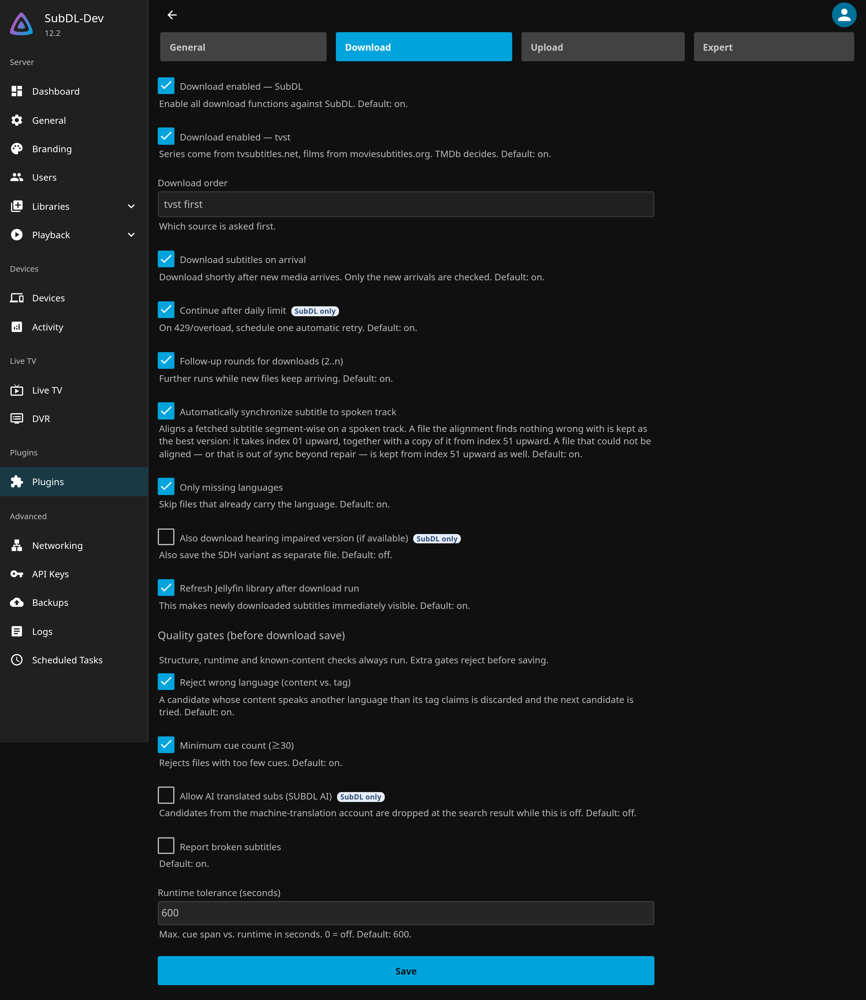
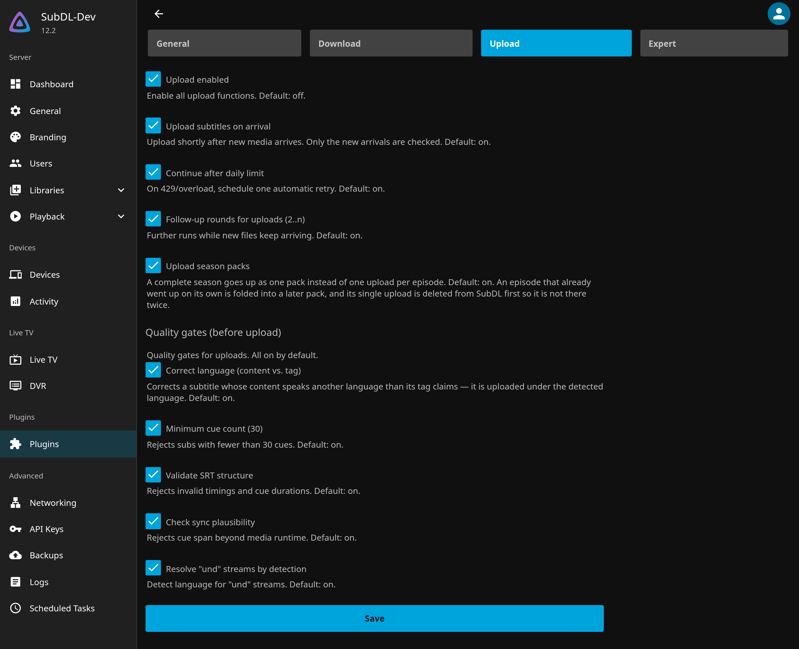

# Sub Scribe

Sub Scribe keeps your Jellyfin library subtitled. It draws on two sources — [SubDL](https://subdl.com)
and [tvsubtitles.net](https://www.tvsubtitles.net) — and **downloads** missing subtitles for the
languages and libraries you select, **synchronizes them to the audio track**, and **uploads** the
subtitle tracks already embedded in your own media files. Each source has its own download and upload
switch, and the order in which the sources are asked is yours to choose.

Written by an **AI agent** under the maintainer's direction.

Licensed under **GPL-3.0-or-later** — see [LICENSE](LICENSE).

## What it looks like

The plugin page in one piece — libraries you opt in, target languages, quota and connection
status, statistics, and when each worker last ran (credentials masked):



**Download** — what gets fetched, when a run happens, and the quality gates a subtitle has to pass
before it is saved:



**Upload** — off by default; the same shape as the download side, with its own gates:



## Requirements

- Jellyfin **12.1.x** (targetAbi `12.1.0.0`)
- A **TMDb API key** — the only mandatory credential
- Optional, per source: a [SubDL](https://subdl.com) account (API key for downloads, username and
  password for uploads). Without it, SubDL is skipped and the remaining source keeps running.

## Installation

### Via the plugin catalog

1. In Jellyfin, open **Dashboard → Plugins → Repositories**.
2. Add this repository URL:

   ```
   https://raw.githubusercontent.com/nrg80/sub-scribe/main/manifest.json
   ```

3. Open **Dashboard → Plugins → All**, find **Sub Scribe** and install it.
4. Restart Jellyfin.

### Manual

1. Download the ZIP of the latest release from the [releases page](../../releases).
2. Create a folder for the plugin under your Jellyfin `plugins/` directory and extract the ZIP into it:

   ```
   /var/lib/jellyfin/plugins/Sub Scribe/
   ├── Jellyfin.Plugin.SubdlSync.dll
   ├── LanguageDetection.dll
   ├── build.yaml
   └── licenses/
       ├── THIRD-PARTY.txt
       ├── LanguageDetection-Apache-2.0.txt
       └── Sub-Scribe-GPL-3.0.txt
   ```

3. Restart Jellyfin.

## Quick start

Open **Dashboard → Plugins → Sub Scribe** and fill in:

1. **TMDb API key** — required, everything else is optional.
2. **Libraries** to scan.
3. **Target languages** for the download side.
4. **Source switches** — one download and one upload switch per source.
5. **Download order** — which source is asked first; the second one gets its own attempt.
6. **SubDL API key** and **SubDL username/password** — *required for SubDL only*. Without them that
   source simply drops out of the chain.

Save.

## Upload (off by default)

Uploads the subtitle tracks embedded in your media files — enable it under **Dashboard → Plugins →
Sub Scribe → Upload → Upload enabled**. Both endpoints are tried in turn, in the configured source
order: a source that is switched off, not configured, already holds the subtitle, or is not allowed to
take it (a downloaded subtitle never travels to the other source) is skipped, and the next one still
runs. Quality gates and duplicate protection apply here exactly as on the download side.

## Build

```bash
./build.sh    # reads the version from build.yaml, writes out/*.zip
```

Releasing is a single command — it builds, verifies the artifact, tags, creates the release and checks that exactly one asset was uploaded:

```bash
scripts/release.sh --dry-run   # build + verify, touch nothing
scripts/release.sh             # the real thing
```

The branch picks the channel: `develop` publishes a prerelease (`v<ver>-dev`), `main` publishes the
stable release. See [Branches](docs/RELEASE.md#branches) for what that means for installs.

Do not release by tagging and pushing alone: a release must carry exactly one asset. See [docs/RELEASE.md](docs/RELEASE.md).

## Documentation

- Functional specification and acceptance criteria: [docs/REQUIREMENTS.md](docs/REQUIREMENTS.md)
- How the two subtitle sources work together (marks, completion, parallel download and upload): [docs/MULTI-SOURCE.md](docs/MULTI-SOURCE.md)
- Release process: [docs/RELEASE.md](docs/RELEASE.md)
